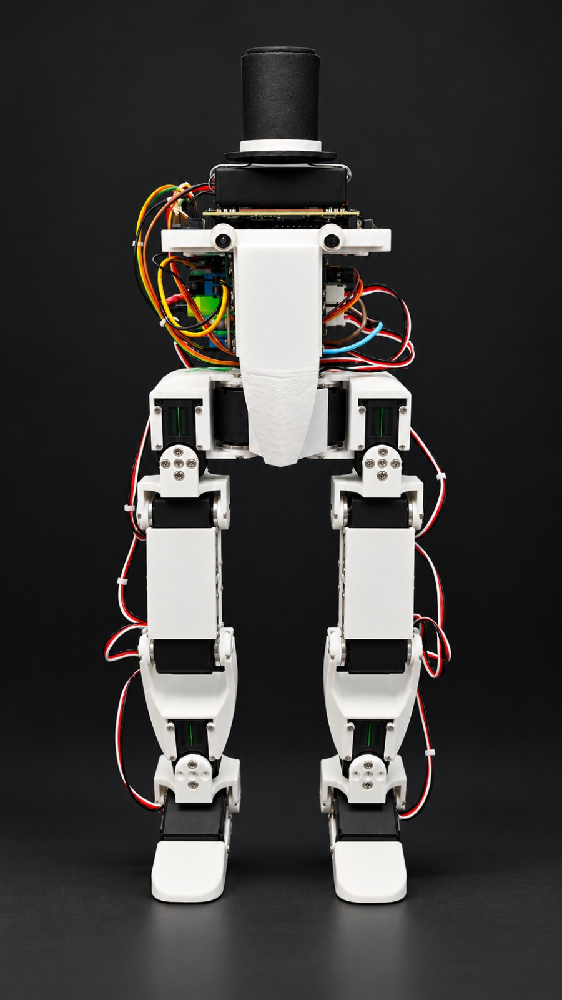

# BipedRobotHardware: Sir Servington

**Open hardware for a small, affordable 12-servo biped that learns to walk in simulation.**
CAD, print files, bill of materials, power PCB, robot description (URDF) and build guide.

<p align="center">
  
</p>

<!-- TODO: replace with a hero GIF of Sir Servington walking (media/walking.gif) -->

| Software | |
|---|---|
| [BipedRobot](https://github.com/AsterisCrack/BipedRobot) | Training (Isaac Lab + MuJoCo), servo model, policy export |
| [BipedRobotJetson](https://github.com/AsterisCrack/BipedRobotJetson) | On-robot runtime: servo bus, IMU, web UI, policy loop |

---

## Specs

| | |
|---|---|
| Height | TODO cm |
| Weight | TODO kg measured (URDF model: 1.66 kg) |
| Degrees of freedom | 12 (per leg: hip yaw, hip roll, hip pitch, knee, ankle roll, ankle pitch) |
| Actuators | 12× Feetech STS3215 (12 V), one shared half-duplex bus at 1 Mbaud |
| Compute | NVIDIA Jetson Orin Nano, 50 Hz control loop |
| IMU | BNO055 on I2C |
| Servo interface | Waveshare Bus Servo Adapter (A) on the Jetson UART |
| Power | Custom power distribution PCB ([electronics/power_pcb](electronics/power_pcb/)) |
| Battery | TODO |
| Runtime | TODO min |
| Structure | 3D-printed, TODO material |
| Cost | About $TODO in parts, prices checked TODO 2026 ([BOM](bom/bom.csv)) |

---

## Where to start

| I want to... | Go to |
|---|---|
| See what to buy and what it costs | [`bom/bom.csv`](bom/bom.csv), [`bom/printed_parts.csv`](bom/printed_parts.csv) |
| Print the parts | [`print/`](print/) and [`print/print_settings.md`](print/print_settings.md) |
| Modify the design | [`cad/step/`](cad/step/) (any CAD tool) or [`cad/fusion/`](cad/fusion/) (Fusion 360) |
| Build it | [`docs/build/`](docs/build/) |
| Order the power board | [`electronics/power_pcb/`](electronics/power_pcb/) |
| Wire it | [`electronics/wiring/`](electronics/wiring/) |
| Simulate it | [`robot_description/`](robot_description/) (URDF + meshes) |

Print files and gerbers are also attached to each [release](https://github.com/AsterisCrack/BipedRobotHardware/releases)
as zips, so you can download them without cloning.

---

## Cost

<!-- TODO: fill from bom/bom.csv once prices are in. Keep the date: prices drift. -->

| Category | Cost (USD) |
|---|---|
| Actuation (12× STS3215) | TODO |
| Compute (Jetson Orin Nano) | TODO |
| Sensing (BNO055) | TODO |
| Power (PCB, battery, regulators) | TODO |
| Electronics (servo adapter, cables) | TODO |
| Fasteners | TODO |
| Filament | TODO |
| **Total** | **About $TODO** (prices checked TODO 2026) |

---

## Repository layout

```
cad/
├── step/              Full assembly + one STEP per part (opens in any CAD tool)
├── fusion/            Fusion 360 archive (.f3z)
└── drawings/          PDFs: critical dimensions, bearing fits
print/
├── stl/               One print-oriented STL per part
├── 3mf/               Plates with slicer settings
└── print_settings.md  Material, layer height, infill, supports
robot_description/     URDF + meshes (ROS package "Robot_description")
electronics/
├── power_pcb/         Power distribution PCB: source, fabrication files, schematic
└── wiring/            Wiring diagram, servo ID map, pinouts
bom/                   Purchased parts and printed parts (CSV)
docs/build/            Step-by-step build guide
media/                 Photos and GIFs
```

The software repos include this one as a git submodule (`robot_hardware/`), so the robot description
used for training and on the robot is always the one in this repo.

---

## Credits

<p>
  
</p>

- The power PCB was fabricated and assembled by [PCBWay](https://www.pcbway.com/), who sponsored this board.
- The servo model used in simulation builds on Rhoban's [BAM](https://github.com/Rhoban/bam).
- The URDF was exported from Fusion 360 with [fusion2urdf](https://github.com/syuntoku14/fusion2urdf)
  (MIT, see [`robot_description/LICENSE-fusion2urdf`](robot_description/LICENSE-fusion2urdf)).

---

## License

The hardware design (CAD, print files, PCB, robot description, documentation) is licensed under the
[CERN Open Hardware Licence Version 2 - Permissive](LICENSE) (CERN-OHL-P-2.0).
The exporter template files in `robot_description/` keep their own MIT licence; the robot design itself is
covered by CERN-OHL-P. The software repos are MIT.
