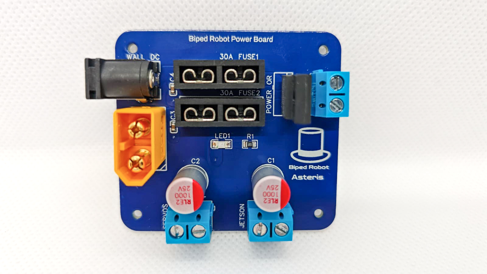
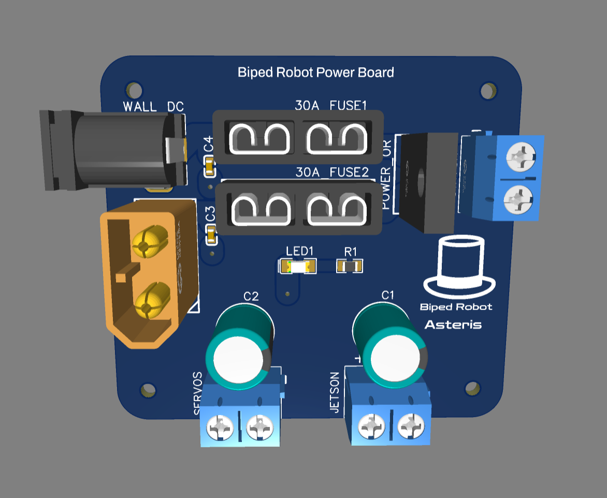

# Power distribution PCB

  
  &nbsp;
  

Takes power from the LiPo (or a 12 V wall adapter on the bench) and distributes it to the servos and the
Jetson, through one power switch.

**Fabricated and assembled by [PCBWay](https://www.pcbway.com/), who sponsored this board.**

## What's on it

| | |
|---|---|
| Inputs | XT60 for a 3S LiPo (11.1-12.6 V) and a DC barrel jack (PJ-002A) for a 12 V wall adapter |
| Protection | A blade fuse on each input (XF-509P holders, FH1 and FH2) |
| Input selection | Dual Schottky diode (SB2060FCT) OR-ing the two inputs, so you can plug both without back-feeding |
| Switch | Screw terminal for an external power switch |
| Outputs | Screw terminals (5.0 mm) for the servos and for the Jetson |
| Other | 2× 1000 µF / 25 V bulk capacitors, power LED |
| Board | 55 × 50 mm, 2 layers. All through-hole except 4 small SMD parts (2 capacitors, LED, resistor) |

Schematic: [`../Schematic_RobotPCB.pdf`](../Schematic_RobotPCB.pdf).

## Files

| Path | Contents |
|---|---|
| [`source/`](source/) | EasyEDA project (`SCH_RobotPCB.json` schematic, `PCB_PCB_RobotPCB.json` board): import it in EasyEDA to modify the board |
| [`fabrication/Gerber_RobotPCB_PCB_RobotPCB_2026-03-17.zip`](fabrication/) | Gerbers + drill files |
| [`fabrication/BOM_RobotPCB_2026-03-17.csv`](fabrication/) | Components, with LCSC part numbers (about $4 of parts) |
| [`fabrication/PickAndPlace_PCB_RobotPCB_2026-03-17.csv`](fabrication/) | Component placement, for assembly |
| [`renders/PCB_render.png`](renders/PCB_render.png) | Board render |

## Getting one

**Recommended: order it.** Upload the gerber zip to [PCBWay](https://www.pcbway.com/) as a 2-layer board.
For a fully assembled board, as on the reference robot, add the BOM and pick-and-place files to the order
and PCBWay will source and solder the parts. You can also order bare boards and solder the parts yourself:
everything except 4 small SMD parts is through-hole.

**Or build it yourself.** The circuit is simple: two fused inputs, a diode OR, a switch, two outputs and some
capacitors. You can wire it on perfboard with the parts in the BOM. It works, but an ordered board is
smaller, tidier and easier to mount in the robot, and it is cheap.
